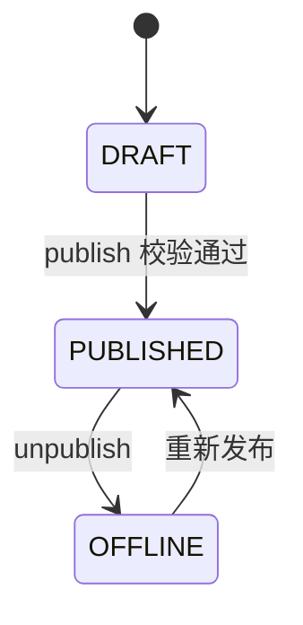
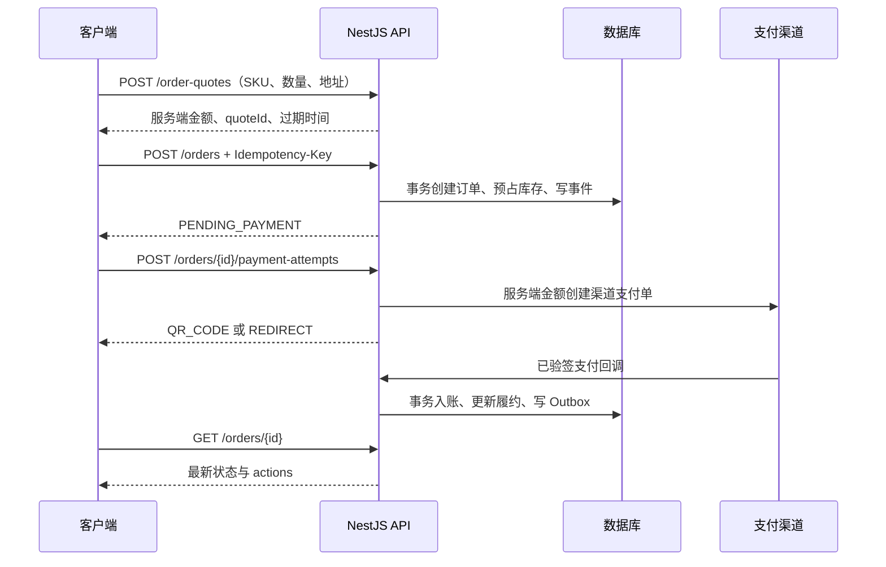
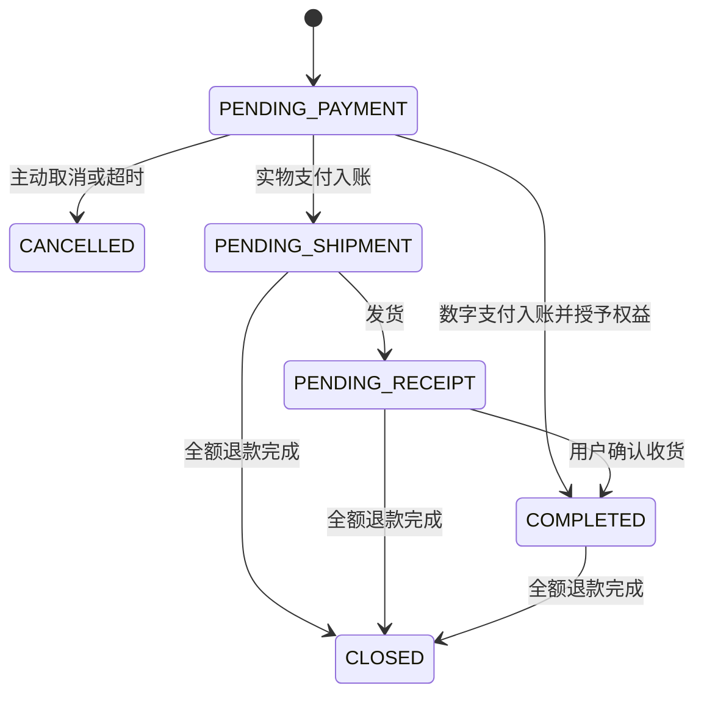
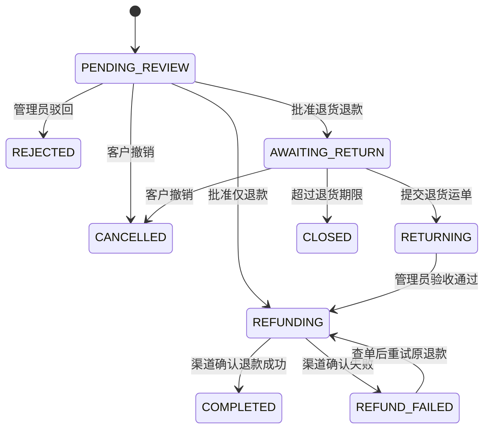

# 业务流程、状态与联调示例

以下请求路径均包含 `/api/v1`。示例 ID、验证码、支付地址和令牌为占位。所有请求与响应字段以 [数据格式](02-data-models.md) 和 [OpenAPI](openapi.json) 为准。

## 内容访问与发布

| kind | 内容组织 | 科普正文／播放入口 | 课程正文／播放入口 |
|---|---|---|---|
| SCIENCE_VIDEO | 单个视频，免费 | GET /videos/{id}/playback | — |
| SCIENCE_ARTICLE | 单篇图文，免费 | GET /articles/{id}/body | — |
| VIDEO_COURSE | 多个视频章节 | — | GET /chapters/{id}/playback |
| ARTICLE_COURSE | 多个图文章节 | — | GET /chapters/{id}/body |

| accessPolicy | 价格 | 完整课程访问 |
|---|---|---|
| FREE | 0 分 | 所有人；不允许为免费内容创建购买订单 |
| PURCHASE | 至少 1 分 | 本人有 ACTIVE 独立购买权益 |
| MEMBER_OR_PURCHASE | 至少 1 分 | 本人有 ACTIVE 独立购买权益，或当前会员有效且方案含 MEMBER_COURSES |

科普只能 FREE。公开元数据接口可展示锁定课程的标题、简介、目录和价格，不能返回完整章节正文或视频源地址。匿名访问被锁章节返回 401 AUTH_REQUIRED，已登录但未授权返回 403 CONTENT_ACCESS_DENIED。预览章节先校验公开可见性，再允许免费访问；不能通过修改 chapterId 跨到其他课程。

课程目录对游客和普通会员只返回 PUBLISHED 章节；持有效独立购买权益者还可查看 OFFLINE 的历史章节，DRAFT 章节始终不会对客户开放。



发布前：分类启用、封面 READY、正文完整。视频素材必须完成转码；图文正文图片必须已就绪。发布课程时至少有一章 PUBLISHED，课程类型和章节类型一致。给最后一个公开章节下架时，必须同时下架所属课程，不能保留空的可售课程。专栏关联草稿内容不会把草稿暴露给客户。

下架停止公开发现和新购买。ACTIVE 独立购买者可通过已购入口继续读取下架课程和历史已发布章节；免费游客、纯会员不能继续读取下架课程。购买后不允许物理删除课程或章节。下架、变更价格和设置专栏均不改写成交订单。

管理员发布视频课程的顺序：

1. POST /uploads，purpose=CONTENT_VIDEO，PUT 到 uploadUrl，再 POST /uploads/{uploadId}/complete。
2. GET /media/{mediaId} 轮询到 READY；封面与图文素材同理。
3. POST /admin/contents，创建 VIDEO_COURSE 草稿。
4. POST /admin/courses/{courseId}/chapters 创建章节，再 PUT /admin/chapters/{chapterId}/body 写入 videoMediaId 和章节 version。
5. POST /admin/chapters/{chapterId}/publish，然后 POST /admin/contents/{courseId}/publish。
6. POST /admin/columns 创建专栏，PUT /admin/columns/{columnId}/contents/{contentId} 关联内容，发布专栏。

更新正文使用所属内容／章节的 version；替换正文会递增该资源版本。读取正文接口返回同一 version，方便继续提交。

## 注册与登录示例

先 GET /public/legal-documents/TERMS 和 /PRIVACY 获取当前协议并展示，用户同意后提交版本。当前注册不需要验证码，不调用短信接口。

```http
POST /api/v1/auth/register
Content-Type: application/json

{
  "phone": "+8613800000000",
  "password": "Example#Password9",
  "nickname": "小雨",
  "termsVersion": "2026-10-01",
  "privacyVersion": "2026-10-01"
}
```

成功 HTTP 201，data 为 AuthTokens，包含 user、accessToken 和轮换用 refreshToken。手机号暂未验证，数据库 phone_verified_at 为 NULL。

```http
POST /api/v1/auth/login/password
Content-Type: application/json

{
  "phone": "+8613800000000",
  "password": "Example#Password9"
}
```

密码登录成功 HTTP 200，返回相同的 AuthTokens。短信发送、短信登录、忘记密码重置当前均未开放；登录后修改密码须提供原密码，成功后所有设备重新登录。刷新令牌每次轮换，前端需单飞刷新并保存新的令牌；旧令牌重放会撤销该会话。运行与数据库配置见 [后端启动与数据库](04-backend-auth.md)。

## 产品下单与支付



```http
POST /api/v1/order-quotes
Authorization: Bearer <clientAccessToken>
Content-Type: application/json

{
  "type": "PRODUCT",
  "addressId": "addr_10001",
  "items": [{"skuId": "sku_10001", "quantity": 2}]
}
```

若 SKU 单价 4900 分、运费 0 分，data.payableAmountCents=9800。报价保存商品、价格和地址快照，绑定当前用户；修改地址簿不会改变已有报价，想用新地址应重新试算。

```http
POST /api/v1/orders
Authorization: Bearer <clientAccessToken>
Idempotency-Key: 74ed8e82-ce32-4bc6-baf4-1fbfe691ae4a
Content-Type: application/json

{"quoteId": "quote_10001"}
```

```http
POST /api/v1/orders/order_10001/payment-attempts
Authorization: Bearer <clientAccessToken>
Idempotency-Key: 2a6c7fc0-10b6-44e1-8941-169b11929e09
Content-Type: application/json

{"channel": "WECHAT_NATIVE"}
```

成功 data 示例：

```json
{
  "id": "pay_10001",
  "orderId": "order_10001",
  "channel": "WECHAT_NATIVE",
  "status": "PENDING",
  "amountCents": 9800,
  "launchType": "QR_CODE",
  "launchUrl": "weixin://wxpay/bizpayurl?pr=example",
  "expiresAt": "2026-10-22T02:30:00Z",
  "paidAt": null,
  "createdAt": "2026-10-22T02:00:00Z"
}
```

二维码展示 launchUrl 原文。ALIPAY_PAGE 返回 launchType=REDIRECT 和网关 HTTPS URL。前端支付完成页只作为展示，应轮询订单或支付尝试；必要时调用支付补查接口，不能自己提交 paid=true。

## 订单、支付与库存状态



| 字段 | 枚举 | 用途 |
|---|---|---|
| order.status | PENDING_PAYMENT / PENDING_SHIPMENT / PENDING_RECEIPT / COMPLETED / CANCELLED / CLOSED | 履约进度；CANCELLED 为未形成合法成交；CLOSED 为成交后整单退款关闭 |
| order.paymentStatus | UNPAID / PAID / PARTIALLY_REFUNDED / REFUNDED | 财务汇总；部分退款时保留原履约状态 |
| order.afterSaleStatus | NONE / PROCESSING / PARTIALLY_COMPLETED / COMPLETED | 售后汇总；有活跃申请优先 PROCESSING；无活跃申请且只退部分为 PARTIALLY_COMPLETED |
| paymentAttempt.status | PENDING / SUCCEEDED / CLOSED / FAILED | 某次渠道尝试；SUCCEEDED 记录真实扣款，即使随后需要补偿退款 |
| refund.status | PENDING / PROCESSING / SUCCEEDED / FAILED | 实际退款进度；仅 SUCCEEDED 计入 refundedAmountCents |

每种状态只接受文档列出的业务命令变更，不提供 PATCH status 的通用接口。订单列表可按三类状态分别筛选；actions 控制前端按钮，调用时仍重新检查。

| 时点 | onHandStock | reservedStock | availableStock |
|---|---:|---:|---:|
| 初始 | 10 | 0 | 10 |
| 创建数量 2 的待支付订单 | 10 | 2 | 8 |
| 支付成功、尚未发货 | 10 | 2 | 8 |
| 发货 | 8 | 0 | 8 |
| 若改为发货前取消／退款完成 | 10 | 0 | 10 |

取消未支付订单、超时关闭、支付回调和发货争抢同一订单锁。未发货售后申请冻结整单发货，批准退款后继续冻结至渠道终态；驳回／撤销／超时关闭申请释放相应占用，订单才可继续发货。预占数量在未发货退款成功时释放；发货后退款不增加库存，退货经质检后显式入库。

取消与支付并发按首次完成的合法事务处理：支付入账先成功则取消返回 ORDER_STATE_INVALID；取消先成功则后续真实到账被记为 LATE_PAYMENT 并原路退款，订单维持 CANCELLED，不发货、不授课、不增加会员。

用户切换渠道或重复支付造成第二笔真实扣款时，只允许首笔合法交易计入成交 paidAmountCents；额外扣款记录在支付台账并生成 DUPLICATE_PAYMENT 退款。补偿退款展示在订单的退款列表，但不计入“合法成交额 refundedAmountCents”，避免超额退款汇总。订单 paymentStatus 汇总合法成交及退款，不会因为取消订单的延迟支付补偿变成已支付。

同一渠道交易回调反复送达只入账一次。入账同时核对商户、外部订单号、币种和金额；验证失败不更新业务数据。不确定是否成功的支付／退款先主动查渠道，不能直接生成新的商户流水号重试。每天对账修复漏通知。

## 发货、查询物流与确认收货

```http
POST /api/v1/admin/orders/order_10001/shipment
Authorization: Bearer <adminAccessToken>
Idempotency-Key: 9c7c47c6-cde0-4610-99dc-5c970f389a02
Content-Type: application/json

{"carrierCode":"SF","trackingNo":"SF1234567890","orderVersion":3}
```

服务端仅发出“原购买数量－已退款数量”的商品；整单已退款不允许发货。发货后为 PENDING_RECEIPT，系统产生物流通知。快递代码的允许值由物流适配器配置，示例 SF 不代表固定只接一家。

客户端 GET /orders/{id}/logistics。未发货时返回 shipment=null、events=[]、syncStatus=NOT_SHIPPED。已发货且第三方临时不可用时保留最后事件，syncStatus=FAILED；前端显示最近同步时间。

确认收货 POST /orders/{id}/confirm-receipt，请求体带最新 version，幂等头必填。已确认或售后并发导致状态变化时重新获取订单，不用前端强制覆盖状态。

## 售后与退款



```http
POST /api/v1/aftersales
Authorization: Bearer <clientAccessToken>
Idempotency-Key: e1c2150f-918b-4f70-ae7b-03ddc46e63b9
Content-Type: application/json

{
  "orderId":"order_10001",
  "type":"RETURN_REFUND",
  "items":[{"orderItemId":"item_10001","quantity":1}],
  "reasonCode":"WRONG_ITEM",
  "description":"收到的商品规格不符",
  "evidenceMediaIds":["media_10001"]
}
```

| 规则 | 处理 |
|---|---|
| 资格 | 仅本人已支付实物订单；未发货 REFUND_ONLY，发货后 RETURN_REFUND；签收确认完成后 7×24h 内 |
| 同时申请 | 一个订单最多一张活跃售后单，可包含多行；活跃状态为 PENDING_REVIEW／AWAITING_RETURN／RETURNING／REFUNDING／REFUND_FAILED，进入终态后才可对剩余数量再申请 |
| 可申请数量 | 购买数量－已退款数量－其他活跃售后冻结数量；创建申请时原子占用 |
| 行退款金额 | 本版无折扣，quantity×成交单价；不能超过剩余可退款金额；客户不能填金额 |
| 运费退款 | 先前已成功退款数量＋本次申请数量覆盖全部商品时，本次冻结并退剩余原运费；同订单串行售后避免并发重复分配，全订单只退一次，不补贴退货运费 |
| 退款上限 | 所有处理中／成功退款合计不超过合法成交实付；重复支付补偿按单独支付台账退款 |
| 管理审核 | 仅退款批准转 REFUNDING；退货退款批准必须给 returnAddress，并转 AWAITING_RETURN |
| 退货验收 | 验收通过才发起退款；有异议保持 RETURNING 并人工跟进，不自动按物流签收退款 |
| 退款失败 | 保持金额和数量占用，返回 REFUND_FAILED，复用原退款号查单后重试 |
| 售后结束 | 仅渠道确认退款成功后 COMPLETED；成功后更新订单已退款数量、金额和对应库存／权益 |
| 部分退款 | 订单继续履约剩余商品；客户可在原申请时限内对剩余数量再次申请 |
| 全额退款 | 订单 status=CLOSED，paymentStatus=REFUNDED，不可发货或确认收货 |

证据图片使用 AFTERSALE_EVIDENCE 用途上传，始终私有。GET 售后详情只给媒体 ID；查看时 POST /media/{id}/read-grant 获取短时图片地址。其他用户和无售后权限的管理员不能获取。

## 课程与会员购买

课程试算：

```json
{"type":"COURSE","courseId":"course_10001"}
```

会员试算：

```json
{"type":"MEMBERSHIP","planId":"plan_30days"}
```

二者都复用 POST /order-quotes → POST /orders → POST /orders/{id}/payment-attempts。无需收货地址；如传入地址或产品 items 会校验失败。合法入账事务完成后，数字订单直接 COMPLETED，再由客户端重取会员／已购列表。

课程权益唯一关联购买来源订单，退款成功撤销该来源的购买权；若用户同时拥有会员权益且课程支持会员，仍可通过会员访问。会员到期不会撤销独立购买课程。

会员按购买成功顺序追加权益段：购买日 10 月 22 日 10:00 开始 30×24h，到 11 月 21 日 10:00 结束；续购从已有段的结束时间追加。每段保留方案、天数、AI 次数和权益编码快照，方案后续改价不改历史。不同方案续费仅在新段开始后切换权益，不把未来高额方案提前生效。

GET /me/membership 返回当前有效段的权益，以及未撤销已购段链的到期时间。没有当前有效段时 active=false、benefitCodes=[]、currentPlanName=null；无任何有效或未来段时 expiresAt=null。会员判断使用 start<=now<end。未来未开始会员段退款成功后撤销该段，并在同一用户权益锁下重排后续未开始段，保持剩余时长和快照不变。

同一个用户并发购买／退款会员时锁定用户权益账本，保证不重复增加或缩短别人的会员段。数字退款只有管理员受控入口，客户端不能修改期限或直接增加会员。

## AI 提问、额度与 SSE

1. GET /ai/quota 展示当前额度。
2. POST /ai/conversations 创建会话。
3. POST /ai/conversations/{id}/messages，带 clientMessageId 与 Idempotency-Key，HTTP 202 返回 AiGeneration。
4. 用 fetch 连接 GET /ai/generations/{id}/events；也可 GET /ai/generations/{id} 轮询。
5. 完成后重新 GET 历史消息确认最终文本；新消息不复用旧 clientMessageId。

```http
POST /api/v1/ai/conversations/conv_10001/messages
Authorization: Bearer <clientAccessToken>
Idempotency-Key: b556108c-1989-4bc4-93fb-e196e4db5c51
Content-Type: application/json

{
  "clientMessageId":"bde07d36-f847-4da9-8fa7-6e4c53e37aa0",
  "content":"怎样理解日常健康管理？"
}
```

SSE 不套统一 JSON 外壳。响应 Content-Type=text/event-stream，事件示例：

```text
id: 1
event: meta
data: {"generationId":"gen_10001","assistantMessageId":"msg_10002"}

id: 2
event: delta
data: {"text":"以下是一般健康知识。"}

id: 3
event: done
data: {"generationId":"gen_10001","assistantMessageId":"msg_10002","finishReason":"STOP"}

```

| event | data 对象 | 处理 |
|---|---|---|
| meta | SseMetaEvent | 关联任务及 assistant 消息；通常第一条 |
| delta | SseDeltaEvent | 按序号去重后拼接文本 |
| done | SseDoneEvent | COMPLETED／CANCELLED／BLOCKED 终态；结束连接并重取最终消息 |
| error | SseErrorEvent | FAILED 终态；显示错误并结束连接 |
| 注释心跳 | `: ping`，无业务 data | 保活，不计入文本或业务序号 |

序号在单一 generation 内递增，业务事件保留至少 10 分钟供 Last-Event-ID 重放。重放不调用模型、不扣额度；游标超出已生成序号返回 400，早于重放窗口返回 410 STREAM_CURSOR_EXPIRED。任务已终态时补发未消费事件后关闭；已消费最后事件则立即关闭。客户端断开连接不取消后台任务，停止按钮调用 /cancel；服务端限制最长生成时间，超时转 FAILED。原生 EventSource 不能直接配置 Bearer 请求头时，使用支持请求头的 fetch 流，不能把 token 放在 URL。

额度按用户＋上海日期原子预占；普通用户默认每天 5 次，会员为当前有效方案限额。remaining=max(0,limit-used-reserved)。当日升级可提高上限，到期或方案切换后按当前额度重算；已使用次数不清零。跨午夜的任务结算到创建任务时的额度日期。

被输入过滤直接拒绝不占额度；输出被过滤且未交付有效文本、模型失败或用户取消且无有效输出，返还预占；已交付有效输出则结算一次。使用量通过独立任务结算记录保证最多一次。生成任务每会话至多一个活跃，并按用户限制并发，防止重复提交绕过限额。

界面将问答标识为健康知识辅助服务；模型不创建诊断或处方，不把回答自动写入用户资料。输入与输出都进行内容过滤，服务端保存私有会话并避免把其他用户资料或内部提示传给模型。管理员用户查询没有问答读取能力。

## 通知与封禁

支付、发货、售后审核／退款、会员到期等事件经 Outbox 发送站内通知。通知目标只包含类型和资源 ID；前端打开目标时仍调用对应受保护接口。通知列表／详情不会自动标记已读；读消息调用 PUT /me/notifications/{id}/read。

批量已读请求携带列表快照时刻 before，仅更新 createdAt<=before 的本人消息，不把后来到达的消息标为已读。群发 ALL_ACTIVE 在任务创建时固定活跃用户集合，按 taskId+userId 去重投递。

封禁后客户端会话立即撤销，禁止新订单、支付发起、问答及受保护内容授权；用户可以作为游客访问公共科普。支付／退款验签回调、对账、物流同步与已付款订单的后台履约继续执行。封禁不等同于取消订单或删除会员，客服仍能处理原有售后。临时封禁到期恢复账号状态，旧 token 仍无效。

## 联调验收场景

| 场景 | 预期 |
|---|---|
| 游客读取已发布科普和预览章 | 200，不要求登录，不暴露非预览章节源地址 |
| 游客读取付费章节 | 401；已登录未购买为 403 |
| 会员读取 PURCHASE 课程 | 仍需独立购买 |
| 会员到期但已独立购买课程 | 继续可读 |
| 内容下架 | 从公共列表消失，已有独立购买者仍可由已购列表访问 |
| 修改课程价格 | 新试算使用新价，已有有效报价与成交快照保留 |
| 两个用户抢最后一件库存 | 最多一单预占成功，另一单 OUT_OF_STOCK |
| 同 quote 不同幂等键并发建单 | 同一业务订单，不重复预占 |
| 同幂等键不同请求体 | 409 IDEMPOTENCY_CONFLICT |
| 支付成功与取消并发 | 一次合法成交或取消后补偿退款，不出现既发货又释放库存 |
| 重复／乱序渠道回调 | 不重复入账、不重复授课、不重复增加会员；成功终态不回退为失败 |
| 超时取消后才到账 | 保留 CANCELLED，生成补偿退款，不发货、不授予权益 |
| 同订单多通道都扣款 | 只一次合法成交，额外扣款补偿退款 |
| 售后申请与发货并发 | 行锁保证互斥；已发货不能再创建仅退款申请 |
| 同一订单并发多次售后 | 最多一个活跃申请，其余 AFTERSALE_IN_PROGRESS；数量和金额总占用不超过剩余可退值 |
| 渠道退款受理但尚未成功 | REFUNDING，不能提前标记 COMPLETED |
| 渠道退款失败后重试 | 原退款号查单，不重复退款或归还库存 |
| 修改地址簿／下架产品 | 历史订单快照保持 |
| 伪造另一个人的订单、消息、会话、凭证 ID | 404，不泄露内容 |
| 管理员缺少权限或使用客户 token | 403 或 audience 验证错误，不返回管理数据 |
| 并发刷新同一 refreshToken | 前端单飞；旧令牌重放撤销该链 |
| 封禁后使用旧 accessToken | 立即拒绝；合法渠道回调继续处理 |
| 重复提交 AI 消息 | 相同任务和消息，不重复扣次数 |
| SSE 断开后重连 | 不重新生成；去重重放；过期游标可通过任务／消息查询恢复 |
| AI 失败／取消时跨日 | 只结算创建日期额度且最多结算一次 |
| 群发任务消费者重试 | 每用户同任务只产生一条消息 |
| 鉴权内容走公共 CDN 缓存 | 不允许跨用户缓存已授权正文／播放地址 |

实施时需补充供应商沙箱联调：短信挑战、对象存储 PUT、视频转码、支付下单／回调验签／退款、快递查询和 AI 流式输出。本文结构校验不能替代真实渠道测试。
